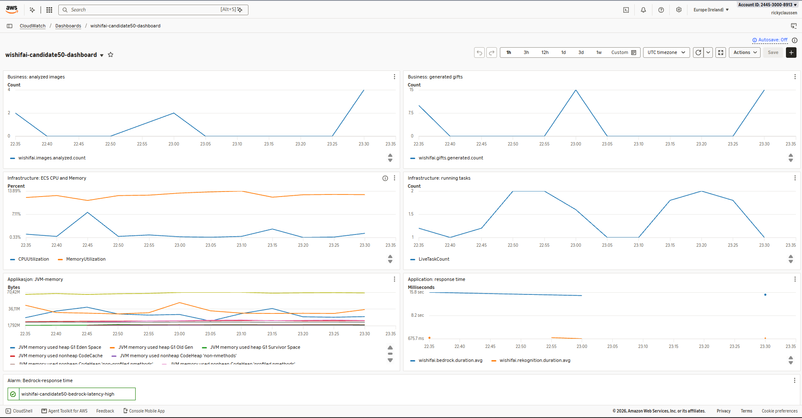
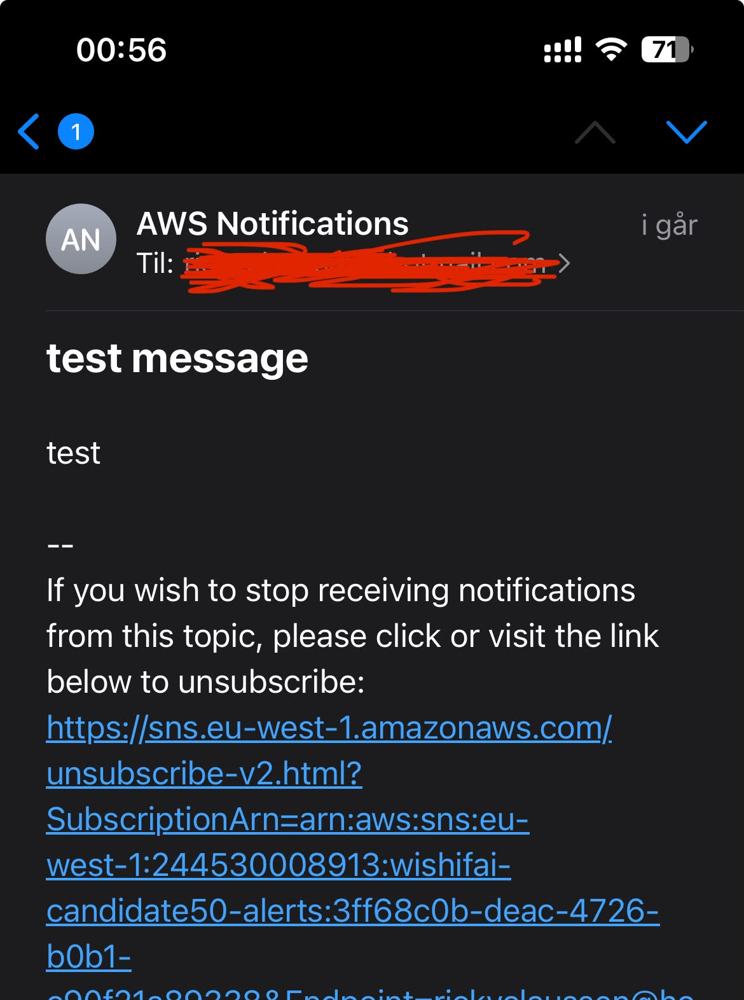

## 1A 
#### Spring Boot-applikasjonen er containerisert. Kjør følgende kommandoer:

#### Bygg imaget:
```bash
docker build -t wishifai .
```
#### Start containeren på localhost:9999:
```bash
docker run --rm -p 9999:8080 -v "$HOME/.aws:/root/.aws:ro" -e AWS_PROFILE=default wishifai
```

## 1B
#### GitHub Actions-workflowen kjører ved push til main.

#### Docker-imaget publiseres til Amazon ECR med to tags (Commit-SHA og latest)
#### Grunnen til at man bruker Commit-SHA er for å enkelt vite akkurat hvilken commit som kjører i et miljø. Derfor brukes denne som primær tag. Latest brukes som en sekundær tag for å se hvilken versjon som er den nyeste.


### Link til grønn workflow-kjøring:
https://github.com/richardclaussen/PGR301-exam/actions/runs/42619784601

## 2A

### Offentlig URL til tjenesten:
https://wi-f311228998ee485590d9ca0f43074768.ecs.eu-west-1.on.aws

## 2B

#### Valgt nøkkel for remote state er "wishifai/50/terraform.tfstate" 

## 2C

#### Det er fornuftig å kjøre Terraform etter container-builden fordi Docker-imaget må være publisert til ECR før ECS kan starte eller oppdatere tjenesten med den nye versjonen. Terraform-jobben bruker commit-SHA'en som image tag. Kjøring av Terraform før eller parallelt kan resultere i at deployen enten feiler siden det ikke finnes noe image i ECR enda, eller at en eldre image-versjon blir brukt.

### Link til grønn workflow-kjøring:
https://github.com/richardclaussen/PGR301-exam/actions/runs/42664430007

## 3A

#### Jeg valgte følgende metrikker:

**wishifai.rekognition.duration:**
Timer for hvor lang tid Rekognition bruker på å analysere et bilde. Det gjør det mulig å følge med på ytelsen til bildeanalysen.

**wishifai.bedrock.duration:**
Timer for hvor lang tid Bedrock bruker på å generere gaveforslag. Brukes for å måle responstiden til språkmodellen.

**wishifai.images.analyzed:**
Counter for antall bilder som er analysert. Dette er en business-metrikk som viser hvor mye tjenesten faktisk brukes.

**wishifai.gifts.generated:**
Counter for totalt antall genererte gaveforslag. Relevant metrikk å ha med siden gavegenerering er tjenestens hovedfunksjon.
 
**wishifai.gifts.per.request**
DistributionSummary for antall gaveforslag per forespørsel. Siden prompten til språkmodellen ber om "inntil" 5 gaver, er det aktuelt å få en innsikt i hvor mange forslag brukerne vanligvis får per bildeanalyse.


## 3B

### Dashboard
  

**Dashboard-navn:**
wishifai-candidate50-dashboard

**Namespace:**
wishifai-candidate50

<br>

**Business-metrikker:** <br>
wishifai.images.analyzed.count - antall analyserte bilder <br>
wishifai.gifts.generated.count - antall genererte gaveforslag

Som nevnt i 3A så viser disse hvor mye tjenesten faktisk brukes, samt hvor mange gaveforslag tjenesten produserer.

<br>

**Infrastruktur-metrikker:** <br>
CPUUtilization - CPU-bruk for ECS-tjenesten <br>
MemoryUtilization - minnebruk for ECS-tjenesten <br>
RunningTaskCount - antall kjørende ECS tasks

Disse viser hvordan tjenesten bruker infrastrukturen og om ECS-tjenesten har kjørende tasks.

<br>

**Applikasjonsmetrikker:**
jvm.memory.used.value - brukt JVM-minne <br>
wishifai.bedrock.duration.avg - gjennomsnittlig responstid fra bedrock <br>
wishifai.rekognition.duration.avg - gjennomsnittlig reponstid fra rekognition

JVM-metrikken eksponeres via Spring Boot Actuator. Responstidmetrikkene er egne metrikker fra applikasjonen. 

<br>



<br>

### Alarm

Jeg la til en alarm for wishifai.bedrock.duration.avg. 
Den heter wishifai-candidate50-bedrock-latency-high

Alarmen går hvis gjennomsnittlig responstid fra Bedrock er over 30 sekunder i to femminuttersperioder på rad.
Ettersom Bedrock er en sentral del av bildeanalyseflyten, er det aktuelt å ha en alarm for høy responstid fordi det gir brukerne en tregere tjeneste og det kan indikere at det er problemer med Bedrock-kallet eller økt belastning.

Alarmen sender varsling til e-postadressen som er konfigurert gjennom GitHub Secret ALERT_EMAIL via et SNS-topic.
Jeg testet å sende en e-post via topicet i AWS-konsollen, og det funket.

<br>



### Testing av dashbordet

Jeg testet dashboardet ved å kjøre denne kommandoen som sto oppført i eksamensteksten:
```bash
curl -F "image=@samples/sample_image.png" http://localhost:8080/api/analyze
```
Responsen var HTTP 200 og dataen dukket opp på dashboardet, som tidligere vist med bilde. Det tok bare litt tid før dataen dukket opp, ettersom dashbordet sjekker femminuttersperioder.


